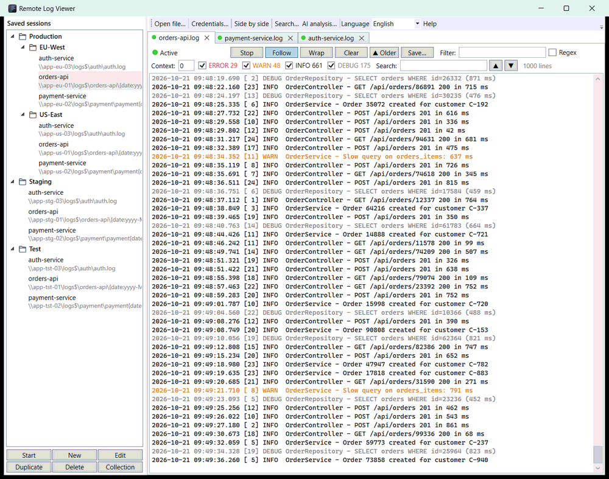
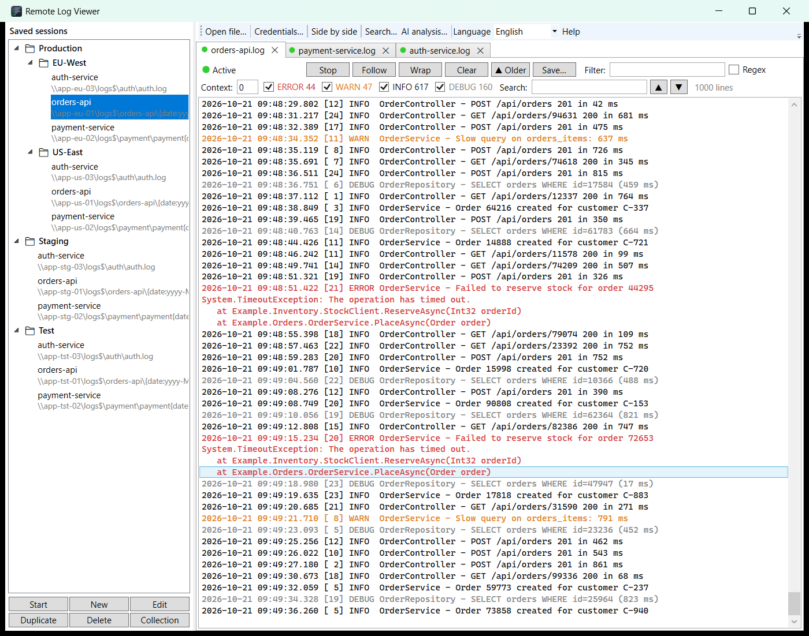
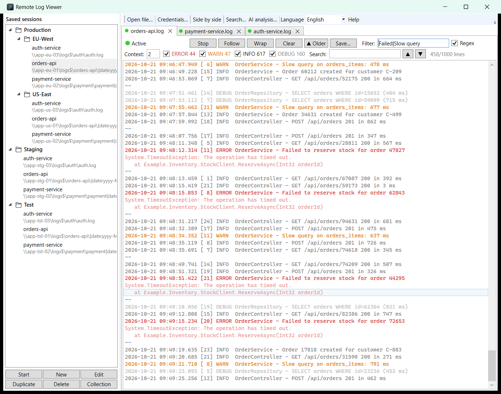
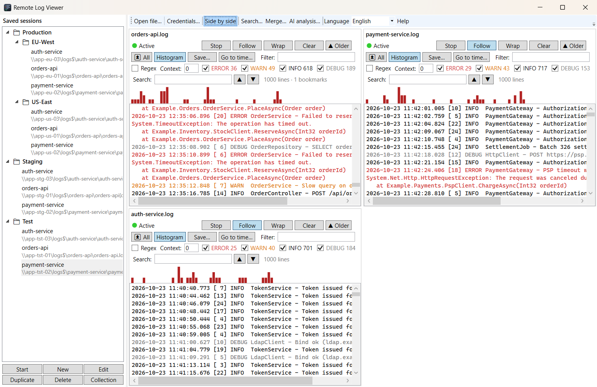
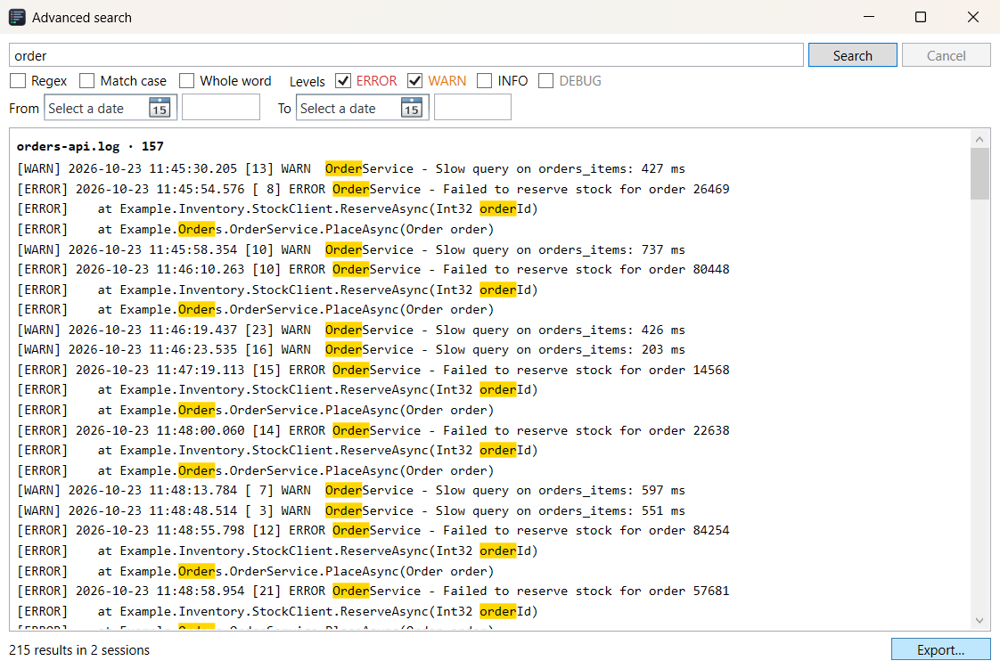

# Remote Log Viewer

**English** · [Italiano](README.it.md)

Windows desktop app (WPF, .NET 10) to follow logs on remote shares. It is designed for Windows servers. It replaces:

```powershell
New-SmbMapping -RemotePath "\\server\E$" -UserName "user" -Password "pwd"
Get-Content -Tail 1000 -Wait "\\server\E$\logs\app.log"
```



## Screenshots

*All sessions, servers and log lines below are fake demo data.*

| | |
|---|---|
|  |  |
| Sessions in collections, tabs, colors and counters per level | Text/regex filter with `grep -C`-style context |
|  |  |
| *Side by side* | *Search…* across all open sessions |

## Features

- Application icon (`src/RemoteLogViewer/app.ico`): exe and main window.
- Saved sessions (share, user, password, file, initial lines, encoding) in `%APPDATA%\RemoteLogViewer\sessions.json`; passwords encrypted with DPAPI (current Windows user).
- Shared **Credentials** (*Credentials…* button in the bar): name + user + password, selectable in each session's *Credential* field instead of its own user/password. When a password changes, only the credential is updated; sessions already open use it from their next opening. Deleting a credential sends the sessions that used it back to their own user/password. Credentials are not exported: import relinks a credential only if it already exists (same PC).
- Real-time tail (500 ms polling), truncation/rotation detection, waiting for a missing file, automatic reconnection.
- **Collections** (nestable folders) to organize sessions: *Collection* button, right-click for new/rename/duplicate/move/delete, drag sessions and collections (onto empty space = root). F2 = edit/rename, Del = delete. *Duplicate* copies the collection with all its content (passwords included) next to the original as `Name (copy)`.
- **Export / import** a collection (or everything, right-click on empty space) to a `.rlv.json` file. Passwords are **not** exported: after the import they must be entered again with *Edit*. Import always adds new copies (conflicting names → `Name (2)`), it never overwrites anything.
- **Date in the path**: `{date:<format>}` in the *File* field, in a folder or in the name, e.g. `FOLDER\APP_NAME\log\standard_logs\{date:yyyy_MM_dd}\log.log` or `logs\app_{date:yyyy-MM-dd}.log`. At start you pick the date on a calendar (default today, with a path preview): days of the displayed month with no log file are crossed out and not selectable (today stays selectable: the session waits for the file). If the chosen date is today, at midnight the session switches by itself to the new day's file (`— new day —` line); a past date stays fixed. Only date components (no hours/minutes), not allowed in the share. If only the old logs have the date and the current one does not (e.g. today `app.log`, yesterday `app.2026-09-29.log`), write `logs\app{date:'.'yyyy-MM-dd}.log` (separator inside the format, quoted) and tick *Today's file has no date*: for today the placeholder disappears and at midnight the session stays on the same file (server-side rotation is detected as usual).
- Several sessions in tabs (reorderable by dragging) or **Side by side** (all visible together, in tab order).
- Colors per level (ERROR/WARN/INFO/DEBUG), level filter (ERROR/WARN/INFO/DEBUG checkboxes; lines without a level always stay visible), text/regex filter, search with highlighting (Ctrl+F, F3/Shift+F3), automatic Follow (stops when you scroll up), *Wrap* button to wrap long lines instead of scrolling horizontally, Ctrl+C copies lines, buffer of at most 100,000 lines.
- **Custom levels and alerts** (session window, *Levels and alerts*): optional case-insensitive regexes for ERROR/WARN/INFO/DEBUG, for logs with non-standard level markers (`[E]`, `|ERR|`, `level=50`): checked in order of severity, then the standard detection; filters, counters, badges and search follow. An *Alert* regex (e.g. `OutOfMemory|deadlock|timeout`) makes new matching lines of any level alert like errors. Applied the next time the session is opened.
- **Per-level counters** in the checkboxes (`ERROR 12`): entries in the buffer (a stack trace counts as 1), independent of the filters, reset by *Clear*.
- **Context** (0–50) next to the filter: shows N lines before/after each filtered line, like `grep -C N`; context lines are dimmed, groups are separated by `--`.
- **▲ Older**: loads another block (= *Initial lines*, 1000 if 0) above the lines already read without interrupting the tail; disabled at the start of the file, after a rotation, or when the session is not active. **⏫ All** loads everything up to the start of the file in one go (within the 100,000-line buffer).
- **Search…** / Ctrl+Shift+F: advanced search across *all* open sessions in a non-modal window: text or regex, match case, whole word, level filter, date+time range; results grouped by tab (max 10,000, snapshot of the buffers); double-click jumps to the line in its tab (clearing that tab's filters if they hide it); *Export…* saves the results to a file.
- **AI analysis…** / Ctrl+Shift+I: sends the visible lines of the checked tabs (max 1 MB, most recent lines kept) plus a prompt (*Error report*, *Summary* or your own question) to a command-line AI tool already installed and signed in: Claude Code (`claude -p --tools "" --no-session-persistence`), Codex (`codex exec --skip-git-repo-check --sandbox read-only --ephemeral -`), OpenCode (`opencode run --agent plan --print-logs --log-level WARN`), Antigravity CLI (`agy --add-dir . -p="Read the file input.md in the current directory and follow the instructions it contains."`: `agy` ignores plain stdin, so the input is also written to `input.md` in the temporary working folder) or a custom command (run with `cmd`, prompt and logs on stdin). The answer streams into the window and can be cancelled, copied, opened formatted in the browser or exported as `.md`/`.html`. Confirmation the first time each tool is used; settings in `%APPDATA%\RemoteLogViewer\ai.json`.
- **Open file…** / Ctrl+O (or drag & drop from Explorer): opens a local log (`.log`, `.txt`, any text file) in a new tab, with no session, credentials or SMB: last 1000 lines then Follow, same filters/search/advanced search/alerts as remote sessions. Not saved in the session list; remembered and reopened at startup if the file still exists.
- **Save…** / Ctrl+S: saves the visible lines (filters and context applied) to a UTF-8 `.log`.
- **Go to time…** / Ctrl+G: type `14:32` (or `2026-10-22 14:32`, `22/10/2026 14:32`) and the first visible line at or after that time is selected (Follow off). Lines without a timestamp inherit the previous one; if the time is before the first line read, *▲ Older* is suggested.
- **Alerts**: red badge with the number of ERRORs (and custom alert lines) on tabs that are not visible (reset by selecting them; no badge in Side by side) and taskbar flashing if the app is not in the foreground. Lines read at opening do not raise alerts.
- **Reopening at startup**: on close, open tabs, order, selection and Side by side are remembered; at start they are reopened without questions (sessions with a date on "today" → current date, fixed date → same date).
- **User guide** (F1 or *Help* button): HTML page in Italian or English, opened in the default browser, works offline.
- **Language** (it/en): *Language* selector in the bar; it applies to the interface and the guide, and the change is immediate, no restart. Default: the Windows language (Italian, otherwise English). Saved in `%APPDATA%\RemoteLogViewer\lang.txt`.

## Install

Each GitHub release (tag `v*`) has two downloads:

- `RemoteLogViewer-vX.Y.Z-setup.exe`: per-user installer (`%LOCALAPPDATA%\Programs\RemoteLogViewer`, no admin rights), with a Start menu shortcut and an uninstaller. Running the setup of a newer version updates the installed one in place. Sessions and settings in `%APPDATA%\RemoteLogViewer` are kept.
- `RemoteLogViewer-vX.Y.Z-win-x64.zip`: portable single exe.

The installer is built by `.github/workflows/installer.yml` (Inno Setup, script `installer/RemoteLogViewer.iss`) after the release workflow succeeds.

## Build / run

```powershell
dotnet build
dotnet test
dotnet run --project src/RemoteLogViewer
```

The local `nuget.config` points to nuget.org (the global NuGet config may have private feeds).

## Notes

- The share connection uses no drive letter (`WNetAddConnection2`); it is released when the session/app closes. Existing mappings created outside the app are left alone.
- "Different credentials" error (1219): Windows allows only one identity per server; close the existing connection (`net use \\server\share /delete`) or use the same credentials.
- Translations: the Italian text is the key, English lives in the table in `src/RemoteLogViewer/L.cs` (`L.T("…")` in code, `{local:T '…'}` in XAML). A missing entry falls back to Italian.
- Specs: `specs/001-remote-log-viewer/`, `specs/001-remote-log-viewer-collections-tabs-datepath/`, `specs/002-usability-improvements/`.
- User guide: `src/RemoteLogViewer/Guida.it.html` / `Guida.en.html` (resources embedded in the exe).
